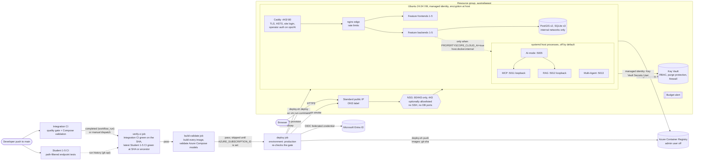

# Azure deployment (Release 2)

This directory holds everything needed to run PropertyScope NSW on Azure: Bicep, a VM bootstrap, the
production Compose wiring, the TLS edge, systemd units for the optional cloud AI tier, the
operations script and the bonus security validations. The design and its trade-offs are recorded
in [ADR-048](../../docs/architecture/decisions/ADR-048-azure-vm-hosting.md).

**Status:** prepared and validated locally. Nothing has been provisioned yet. Once a subscription
is chosen, deployment is a configuration step: work through the
[switch-on checklist](#switch-on-checklist) in order.

## Architecture



| Path | Purpose |
|---|---|
| `main.bicep`, `modules/*.bicep` | Network, registry, Key Vault, VM, role assignments, auto-shutdown, budget |
| `main.bicepparam` | Production parameters; values come from environment variables or GitHub variables |
| `dev.bicepparam` | Example low-cost rehearsal environment in its own resource group |
| `cloud-init.yaml` | First boot: Docker Engine and Compose plugin, Azure CLI, uv, the `propertyscope-ai` user, SSH disabled |
| `../../docker-compose.azure.yml` | Production override: ACR images by SHA, only Caddy publishes ports, file secrets, internal data networks, AI off |
| `../../docker-compose.azure-ai.yml` | Cloud AI overlay: host-gateway wiring for the bonus tiers |
| `Caddyfile`, `caddy/` | TLS edge, redirect, HSTS and security headers, operator auth, AI on/off switch |
| `nginx/00-propertyscope-production.conf` | Production-only nginx include: rate limits, timeouts, body limit, no version banner |
| `compose/` | Entrypoint shims that turn Compose secret files into process-only environment variables |
| `systemd/` | `propertyscope-ai.target` plus AI-mode, MCP, RAG and Multi-Agent units |
| `vm/propertyscope-vm.sh` | Runs on the VM through run-command: deploy, AI on/off, status, logs, on-host validation |
| `deploy.sh` | The operator and CI entry point (below) |
| `validate-endpoint-security.sh`, `validate-data-security.sh` | Bonus B5 and B6 validation |
| `validate-iac.sh` | Offline Bicep, ShellCheck, Caddy, nginx and cloud-init checks (CI job `iac-lint`) |

## Switch-on checklist

Do these steps in order, once, after choosing the subscription. Steps 1 to 6 need a subscription
Owner (or Contributor plus User Access Administrator). Replace the placeholders. None of the
values below is a secret.

```bash
SUBSCRIPTION_ID=<subscription-guid>
RG=rg-propertyscope-prod
LOCATION=australiaeast
REPO=MattShelton04/41026ASDProject
az login
az account set --subscription "$SUBSCRIPTION_ID"
```

0. **Check that the subscription can host the VM.** Student and sponsored subscriptions (for
   example *Azure for Students*) are the usual cause of a failed first deployment:

   - **Credit and spending limit.** The VM costs about US$0.25 per running hour (see
     [Costs](#costs-and-deallocation)). When a credit-based subscription reaches its spending
     limit, Azure stops its resources until the next credit period. Keep auto-shutdown on and
     deallocate between demonstrations.
   - **vCPU quota and allowed regions.** `Standard_D4s_v5` needs 4 vCPUs of the DSv5 family in
     the region. Student subscriptions often have a small regional quota, and some are limited to
     certain regions by policy. Check both before provisioning:

     ```bash
     az vm list-usage --location "$LOCATION" --output table | grep -Ei 'total regional|DSv5'
     az vm list-skus --location "$LOCATION" --size Standard_D4s_v5 --query "[].restrictions" --output json
     ```

     An empty `restrictions` list means the size is offered. Otherwise request more quota, or
     set `AZURE_LOCATION` and `AZURE_VM_SIZE` (any size with 16 GiB or more) for both the laptop
     and the GitHub variables.
   - **Budgets.** `provision` creates a monthly Cost Management budget when `AZURE_BUDGET_EMAILS`
     is set. If the subscription's offer does not support Cost Management budgets, the deployment
     can fail on the budget resource: set `AZURE_DEPLOY_BUDGET=false` and watch the credit balance in the portal instead.
   - **App registrations.** Step 3 creates an Entra ID app registration. Many university tenants
     do not let students register applications. If `az ad app create` is refused, ask a tenant
     administrator to create the app and its federated credential (step 3) for you.

1. **Register the resource providers and the encryption-at-host feature.** Registration takes a
   few minutes. Wait until the feature shows `Registered`.

   ```bash
   for ns in Microsoft.Compute Microsoft.Network Microsoft.ContainerRegistry Microsoft.KeyVault \
             Microsoft.DevTestLab Microsoft.Consumption; do az provider register --namespace "$ns"; done
   az feature register --namespace Microsoft.Compute --name EncryptionAtHost
   az feature show --namespace Microsoft.Compute --name EncryptionAtHost --query properties.state -o tsv
   az provider register --namespace Microsoft.Compute   # propagate the feature once Registered
   ```

   If the feature cannot be registered, set `AZURE_ENCRYPTION_AT_HOST=false`. Managed disks are
   still encrypted at rest with platform keys, but host caches and the temporary disk are not, so
   the B6 check reports this as a failure.

2. **Create the resource group.** `deploy.sh provision` also creates it when it is missing, but
   creating it here lets the deployer identity be scoped to it.

   ```bash
   az group create --name "$RG" --location "$LOCATION"
   ```

3. **Create the GitHub deployer identity with an OIDC federated credential.** It has no client
   secret.

   ```bash
   APP_ID=$(az ad app create --display-name propertyscope-github-deployer --query appId -o tsv)
   SP_ID=$(az ad sp create --id "$APP_ID" --query id -o tsv)
   az ad app federated-credential create --id "$APP_ID" --parameters '{
     "name": "github-production-environment",
     "issuer": "https://token.actions.githubusercontent.com",
     "subject": "repo:MattShelton04/41026ASDProject:environment:production",
     "audiences": ["api://AzureADTokenExchange"]
   }'
   RG_ID=$(az group show --name "$RG" --query id -o tsv)
   az role assignment create --assignee-object-id "$SP_ID" --assignee-principal-type ServicePrincipal \
     --role Contributor --scope "$RG_ID"
   # Lets the Bicep template create its own least-privilege role assignments (AcrPull, Key Vault
   # Secrets User/Officer, AcrPush) inside this resource group only.
   az role assignment create --assignee-object-id "$SP_ID" --assignee-principal-type ServicePrincipal \
     --role "Role Based Access Control Administrator" --scope "$RG_ID"
   echo "AZURE_CLIENT_ID=$APP_ID  AZURE_DEPLOYER_PRINCIPAL_ID=$SP_ID  AZURE_TENANT_ID=$(az account show --query tenantId -o tsv)"
   ```

   In Git Bash on Windows, run these with `export MSYS_NO_PATHCONV=1` first: Git Bash otherwise
   rewrites the `/subscriptions/...` scope into a Windows path and az fails with
   `MissingSubscription`. `deploy.sh` and its validators already do this for every az call.

   The job uses `environment: production`, so the token subject is always
   `repo:MattShelton04/41026ASDProject:environment:production`. A credential for
   `ref:refs/heads/main` is **not** needed and would not match.

4. **Configure the GitHub `production` environment and variables.** In *Settings →
   Environments*, create `production`. Add required reviewers to record a human approval for each
   deployment, and limit deployment branches to `main`. Then, in *Settings → Secrets and
   variables → Actions → Variables*, add these repository variables. Leave
   `AZURE_SUBSCRIPTION_ID` until last: setting it is what switches the workflow on.

   | Variable | Example | Required |
   |---|---|---|
   | `AZURE_TENANT_ID` | tenant GUID | yes |
   | `AZURE_CLIENT_ID` | `$APP_ID` from step 3 | yes |
   | `AZURE_RESOURCE_GROUP` | `rg-propertyscope-prod` | yes |
   | `AZURE_DNS_LABEL` | `propertyscope-nsw-g20` (unique in the region; empty also means this default) | yes |
   | `PROPERTYSCOPE_ACME_EMAIL` | team address for certificate notices | yes |
   | `AZURE_DEPLOYER_PRINCIPAL_ID` | `$SP_ID` (granted AcrPush) | recommended |
   | `AZURE_BUDGET_EMAILS` | `a@uni.edu,b@uni.edu` (the budget is skipped while empty) | recommended |
   | `AZURE_SECRET_OFFICER_IDS` | object IDs of the operators who run `deploy.sh secrets` | recommended |
   | `AZURE_OPERATOR_IP_RANGES` | operator public IPv4/CIDR list for the Key Vault firewall | optional |
   | `AZURE_ALLOWED_HTTPS_SOURCES` | `203.0.113.7/32,198.51.100.0/24` limits HTTPS (443) to these sources; empty means the internet. Port 80 always stays open ([Access control](#access-control)) | optional |
   | `PROPERTYSCOPE_SITE_AUTH`, `PROPERTYSCOPE_SITE_USER` | site-wide viewer login, defaults `on` and `propertyscope`; `off` makes pages public | optional |
   | `AZURE_LOCATION`, `AZURE_VM_SIZE`, `AZURE_ENCRYPTION_AT_HOST`, `AZURE_MONTHLY_BUDGET` | defaults `australiaeast`, `Standard_D4s_v5`, `true`, `100` | optional |
   | `AZURE_SUBSCRIPTION_ID` | subscription GUID. The workflow skips until this is set | yes, last |

   **One GitHub secret, and no cloud credential.** While the site-wide login is on, add the
   *environment* secret `PROPERTYSCOPE_SITE_PASSWORD` to `production` after step 6: the smoke
   test and the B5 validation sign in with it, and only those two steps receive it. Azure access
   is OIDC, and the provider key for the optional AI tier goes into Key Vault, never into GitHub.
   An unset variable reaches the parameter files as an empty value,
   and `main.bicepparam` treats empty as "use the default", so a missing optional variable never
   produces an empty region, VM size or DNS label.

5. **Provision once from a laptop.** Copy `.env.azure.example` to `.env.azure` (Git-ignored) and
   fill in the same values. Put your own object ID in `AZURE_SECRET_OFFICER_IDS`. Use
   `az ad signed-in-user show --query id -o tsv` to find it.

   ```bash
   bash deployment/azure/validate-iac.sh          # offline: Bicep, ShellCheck, Caddy, nginx
   bash deployment/azure/deploy.sh provision
   ```

   The first run creates every resource, including the VM, and takes about 10 minutes. Later
   runs converge the same resources.

6. **Create the runtime secrets in Key Vault.**

   ```bash
   # The vault firewall denies the internet; admit this machine for the call only:
   KEY_VAULT_CLIENT_IP=<your public IPv4> bash deployment/azure/deploy.sh secrets
   # Optional: choose the viewer password you will hand to markers (12+ characters) instead of
   # a random one, and the provider key for the bonus AI tiers:
   PROPERTYSCOPE_SITE_PASSWORD=... OPENAI_API_KEY=... KEY_VAULT_CLIENT_IP=<ip> bash deployment/azure/deploy.sh secrets
   ```

   `secrets` creates each missing secret, with a random 64-character value unless one is given
   above, and never overwrites an existing one. Rotate a secret by deleting it, rerunning
   `secrets` and redeploying. Then give GitHub the viewer password (read it from the portal, or
   with `az keyvault secret show --vault-name <vault> --name edge-site-password --query value -o tsv`):

   ```bash
   gh secret set PROPERTYSCOPE_SITE_PASSWORD --env production
   ```

   | Key Vault secret | Used by |
   |---|---|
   | `internal-token` | backend-to-database-API service token (all features) |
   | `runner-token` | Feature 1 runner-to-backend token |
   | `f1-postgres-password`, `f4-postgres-password` | PostGIS superuser passwords. The VM also renders the database URLs |
   | `edge-basic-auth-password` | operator password for `/operations/*`, AI, release-review and data-pipeline routes (user `propertyscope-operator`). It also opens the site-wide login |
   | `edge-site-password` | the shared viewer password for the site-wide login (user `propertyscope`, `PROPERTYSCOPE_SITE_USER`). Read only while `PROPERTYSCOPE_SITE_AUTH=on` |
   | `ai-mode-service-token`, `multi-agent-service-token` | host AI-mode and Multi-Agent entry tokens. Read only when the AI tier is on, and handed to the edge and backends as Compose secrets |
   | `mcp-service-token`, `rag-service-token` | host MCP and RAG tokens (AI tier only; root-only on the VM) |
   | `openai-api-key` (optional) | AI-mode provider key, handed to systemd as a credential file |
   | `github-repo-token` (optional) | read-only token, needed only if the repository becomes private (AI tier source checkout) |

7. **Run the workflow.** Set `AZURE_SUBSCRIPTION_ID` (step 4), then run *Cloud Deployment* by
   hand, or push to `main` and let it follow a green *Integration CI*. Approve the `production`
   environment when GitHub asks. From a laptop, `bash deployment/azure/deploy.sh all` does the
   same. On a first deployment the VM waits, with backoff, for the new AcrPull and Key Vault
   role assignments and the vault firewall rule to take effect (up to about 8 minutes,
   `PROPERTYSCOPE_AUTH_RETRY_ATTEMPTS`), then gives the stack up to 15 minutes to become healthy
   (`PROPERTYSCOPE_STARTUP_WAIT_SECONDS`). The first certificate can take a few more minutes.

8. **Smoke-test the public URL.** The workflow runs `deploy.sh smoke` after the deployment. To
   repeat it, run `PROPERTYSCOPE_SITE_PASSWORD=... bash deployment/azure/deploy.sh smoke`. It
   proves the site login turns anonymous callers away, then signs in as the viewer and checks the
   home page, every feature route and health endpoint, one self-cleaning CRUD case per feature,
   and that AI is off.

9. **Review the evidence.** Run `deploy.sh validate-endpoint` (B5) and `deploy.sh validate-data`
   (B6), and read `cloud-deployment-report.md` in the workflow artifact (or
   `.propertyscope-runtime/cloud/`). Copy the accepted report into
   `docs/release-2/evidence/cloud/`.

10. **Decide what stays on.** Choose one: keep the VM for the demonstration (it deallocates daily
    at 23:30 AEST), deallocate it now ([Costs](#costs-and-deallocation)), enable the bonus AI
    tier with `deploy.sh ai on`, or [tear it down](#teardown). Unset `AZURE_SUBSCRIPTION_ID` to
    stop further deployments.

## Access control

Three layers decide who reaches what. All of them are on or tight by default except the
network allowlist, which needs your addresses.

| Layer | Default | Who gets in | Change it with |
|---|---|---|---|
| NSG: HTTPS (443) | the internet | the sources in `AZURE_ALLOWED_HTTPS_SOURCES` (comma-separated IPv4/CIDR, or a service tag) | the variable, then `deploy.sh provision` |
| NSG: HTTP (80) | the internet, always | everyone, but Caddy only answers ACME challenges and a redirect to HTTPS | not configurable: Let's Encrypt validates and renews over port 80 from addresses it does not publish |
| Site-wide login (Caddy) | **on** | the viewer `propertyscope` (Key Vault `edge-site-password`) or the operator, on every page and API except `/healthz` | `PROPERTYSCOPE_SITE_AUTH=off`, then `deploy.sh deploy` |
| Operator login (Caddy) | on, always | the operator `propertyscope-operator` (`edge-basic-auth-password`) on operations, AI, data-pipeline and release-review routes | not configurable |

- **For marking, prefer the site login over an IP allowlist.** Markers and teammates join from
  campus, home and mobile networks whose addresses change, and a missing address looks like a
  site that is down. Share the viewer user and password privately (not in the repository, the
  report or a public channel), and rotate `edge-site-password` afterwards.
- **An allowlist suits a fixed audience,** such as a demonstration from one lab. While 443 is
  restricted, `deploy.sh smoke` and `deploy.sh validate-endpoint` add a temporary NSG rule
  (`AllowDeployerHttpsTemporary`, priority 120) for this machine's public IPv4 address and remove
  it when they exit, so a GitHub-hosted runner can still check the edge. They look the address
  up with `https://api.ipify.org` unless `PROPERTYSCOPE_CLIENT_IP` is set. The next `provision`
  also removes any rule left behind.
- **Browsers ask twice for operator pages.** The viewer and operator logins use separate
  realms, so a browser that holds the viewer login asks again on `/operations/*`. Signing in with
  the operator login from the start opens both.
- `/healthz` stays anonymous for uptime checks and the B5 certificate check. It returns only
  `ok`.

## Using `deploy.sh`

Run the script from Git Bash, WSL, Linux or macOS. On Windows, `uv run scripts/dev.py cloud ...`
finds Git Bash for you; the script turns off Git Bash path conversion for its az calls, so
Azure resource IDs (`/subscriptions/...`) reach az unchanged. Every subcommand accepts `--dry-run`, which prints each mutating Azure or
Docker command instead of running it. The run-command payloads are written to
`.propertyscope-runtime/cloud/` for inspection.

| Command (`deploy.sh …` or `dev.py cloud …`) | What it does |
|---|---|
| `provision` | Creates the resource group if missing, recovers a soft-deleted PropertyScope Key Vault left by a teardown, and applies `main.bicepparam`. If the VM already exists, it converges everything else, because the VM's customData and SSH key are immutable |
| `secrets` | Creates missing Key Vault secrets (see the table above) |
| `push [--reuse-images]` | Builds every enabled image, then pushes `propertyscope/<service>:<git-sha>` to ACR and mirrors Caddy and PostGIS into ACR. An uncommitted tree gets the tag `<sha>-dirty`. `--reuse-images` skips the build only when this machine already built this clean commit's images (their IDs are recorded under `.propertyscope-runtime/cloud-builds/`); it never reuses a `-dirty` tag. `PROPERTYSCOPE_BUILD_TAG` builds under a local tag other than `dev` |
| `deploy` | Starts the VM if it is deallocated, then through run-command: installs the commit's Compose and edge bundle, renders secrets from Key Vault with the managed identity, `az acr login`-equivalent token exchange, `compose pull`, `compose up -d --wait`, checks the seeded baseline, and runs the `fixture-property` collection once. Key Vault reads, the ACR login and the pull retry with backoff while new role assignments propagate |
| `smoke [--expect-ai] [--insecure]` | `scripts/cloud_smoke.py` against `https://<fqdn>`: with the site login on (needs `PROPERTYSCOPE_SITE_PASSWORD`), anonymous 401 and a public `/healthz`, then as the viewer: home page, each feature route and health, one self-cleaning CRUD case per feature (Feature 1 also updates its record), and the AI-off check. It passes the deployment identity (`--commit-sha`, `--image-tag`, `--registry`) and, after a deploy, `--vm-log vm-deploy.log`, so `cloud-smoke.json` records the images the VM reported running, with registry digests |
| `ai on` / `ai off` | Bonus tiers: checks out the deployed SHA on the VM, `uv sync`s it, prepares the RAG model and corpora, starts the systemd units and applies the AI overlay. `off` reverses all of this |
| `status`, `logs [service] [lines]` | Container health, AI units and listening sockets. Recent Compose logs, or journal logs for `ai-mode`, `mcp`, `rag` and `multi-agent` |
| `outputs` | FQDN, ACR login server, VM name and Key Vault name from the Bicep deployment |
| `validate-endpoint`, `validate-data` | Bonus B5 and B6 evidence (`endpoint-security.txt`, `data-security.txt`) |
| `all` | `provision`, then `push`, `deploy` and `smoke` |

Logs and reports are written to `.propertyscope-runtime/cloud/` (Git-ignored). The workflow
uploads that directory as an artifact and runs `scripts/cloud_deployment_report.py` to produce
`cloud-deployment-report.md`. Copy the accepted report into `docs/release-2/evidence/cloud/`.

### Data in the cloud

A fresh cloud database holds the **seeded demonstration baseline** that the Feature 1 migrations
create: about 10 synthetic records per dataset, labelled as such. `deploy` also runs the
`fixture-property` collection once, which ends at a candidate release that a human must review.
Real data is collected and published in the cloud only through the normal Feature 1 review (see
the `feature-1-data` skill). Protected data-pipeline routes require the operator credentials.

### Bonus tiers (B1–B6)

- **B5 endpoint security:** Caddy provides TLS, the HTTP→HTTPS redirect, HSTS and security
  headers, the site-wide viewer login (anonymous callers get 401 everywhere but `/healthz`; the
  viewer login never opens an operator route), and basic auth on operations, AI, pipeline and
  release-review routes. Any feature's
  `assistant/turns`, `agent-runs`, `case-summary-runs`, `multi-agent` or `release-reviews`
  collection is protected generically, so Feature 1's Multi-Agent proxy
  (`/api/data-platform/v1/release-reviews`) needs operator credentials. nginx adds `limit_req`
  with 20 r/s on `/api/` and `/fragments/` and 30 r/min on the same sensitive routes. The
  validator bursts `/fragments/rate-limit-probe`, a static miss that nginx answers after
  `limit_req`. An nginx `return` (such as the catch-all `/api/` 404) runs before `limit_req`
  and can never answer 429; while the site login is on the burst signs in as the viewer. The
  NSG admits 80/443 only, keeps 80 open for certificates and optionally limits 443
  ([Access control](#access-control)). Evidence: `deploy.sh validate-endpoint`.
- **B6 data security:** secrets are kept only in Key Vault and read by the managed identity, the
  repository holds no cloud secret (OIDC), disks are encrypted at host and at rest, databases sit
  on internal networks, and no secret appears in `docker inspect` or image history. Evidence:
  `deploy.sh validate-data`.
- **B1–B4 AI:** `deploy.sh ai on`, then exercise each tier from a feature UI. Use
  `deploy.sh smoke --expect-ai` and the feature evidence in `docs/release-2/evidence/bonus/`.
  Turn it off again with `deploy.sh ai off`. The workflow always deploys with AI off.

## Costs and deallocation

These are approximate pay-as-you-go prices. Check the Azure pricing calculator for your
subscription.

| Resource | Approximate cost |
|---|---|
| `Standard_D4s_v5` VM | about US$0.25 per running hour (about US$180 per month if never stopped) |
| 128 GiB Premium SSD OS disk | about US$20 per month (charged while deallocated) |
| ACR Basic | about US$5 per month |
| Standard static public IP | about US$4 per month |
| Key Vault, budget, auto-shutdown | cents |

The VM deallocates every day at 23:30 AEST (`AZURE_AUTO_SHUTDOWN_TIME`), and `deploy`
starts it again automatically. Deallocate it by hand between demonstrations. The static IP and
the FQDN survive deallocation.

```bash
az vm deallocate --resource-group rg-propertyscope-prod --name propertyscope-prod-vm
az vm start      --resource-group rg-propertyscope-prod --name propertyscope-prod-vm
```

The budget emails `AZURE_BUDGET_EMAILS` at 50% and 80% of actual spend and at 100% of forecast
spend.

## Teardown

```bash
az group delete --name rg-propertyscope-prod --yes          # every resource, including the budget
az ad app delete --id <AZURE_CLIENT_ID>                      # the GitHub deployer and its federated credential
```

Key Vault purge protection keeps the deleted vault, and its name, for 7 days. It cannot be purged
early, and the vault name is derived from the resource group ID, so a new group with the same
name wants the same vault. `deploy.sh provision` therefore recovers the soft-deleted vault
(with its secrets) before it deploys. Listing deleted vaults needs subscription-level read, so
run that first `provision` from a laptop as an Owner; the resource-group-scoped GitHub deployer
only logs that it cannot check. To start with a fresh, empty vault instead, set
`AZURE_KEY_VAULT_NAME_SEED` to any new value and rerun `provision` and `secrets`. Remove the
GitHub variables to make the workflow skip again.

## Local validation (no Azure needed)

```bash
uv run pytest scripts/tests -q -k "azure or cloud or workflow or architecture"
bash deployment/azure/validate-iac.sh     # Bicep build/lint/params, ShellCheck, caddy validate/fmt, nginx -t + 429 burst
ACR_LOGIN_SERVER=example.azurecr.io IMAGE_TAG=0000000 PROPERTYSCOPE_PUBLIC_HOST=example.test \
PROPERTYSCOPE_ACME_EMAIL=ops@example.test PROPERTYSCOPE_SECRETS_DIR=<dir with dummy files> \
  docker compose -f docker-compose.yml -f deployment/enabled-features.compose.yml \
  -f docker-compose.azure.yml --profile release-0 config --quiet
PROPERTYSCOPE_ACME_EMAIL=ops@example.test bash deployment/azure/deploy.sh --dry-run deploy
uv run python scripts/cloud_smoke.py --base-url http://localhost:5100 --expect-ai   # against a local stack
az bicep install && az bicep build --file deployment/azure/main.bicep               # Bicep only
```

## Local rehearsal

`uv run scripts/dev.py cloud rehearse` runs the whole deployment path on this machine, as close
to the VM flow as Docker allows, in about 10 minutes (longer on the first build). Run it before
the real deployment, and after any change to this directory or the Compose files. It needs
Docker and Git Bash (on Windows), free loopback ports 80, 443 and 5000, and internet access only
to pull base images and packages. It never calls `az`: `deploy.sh` refuses every `az` call in
rehearsal mode, and child scripts find a refusing `az` first on `PATH`.

| Stage | What runs |
|---|---|
| prepare | `.propertyscope-runtime/cloud-rehearsal/`: the VM's `/etc/docker/daemon.json` taken from `cloud-init.yaml`, and a random value for every Key Vault secret (a directory standing in for Key Vault; never printed) |
| infrastructure | Compose project `ps-azure-rehearsal` ([`rehearsal/compose.yml`](rehearsal/compose.yml)): `registry:2` as `ps-rehearsal-registry` in place of ACR, and a Docker-in-Docker container in place of the VM. Only 80/443 (and the registry's 5000) are published, on the host loopback |
| push | `deploy.sh push`: builds under `propertyscope/<service>:rehearsal` (the shared `:dev` images are untouched), pushes `:<git sha>` and the Caddy/PostGIS mirrors to the registry |
| deploy | `deploy.sh deploy`: the exact run-command payload (bundle extraction, `propertyscope-vm.sh deploy`) runs as root in the rehearsal VM through `docker exec`. The VM script renders the secrets, pulls every image from the registry into an empty engine, starts `docker-compose.azure.yml` with AI off as project `ps-azure`, checks the seeded baseline and runs the `fixture-property` collection |
| smoke | `deploy.sh smoke --insecure` against `https://localhost` (Caddy's internal CA) with the stand-in viewer password: the site-login check, then every page, health route, CRUD case (Feature 1 with its update) and the AI-disabled check |
| endpoint_security | `deploy.sh validate-endpoint` (B5) with the stand-in operator and viewer passwords and `EDGE_CA_FILE` set to Caddy's internal root and intermediate, so the HTTP-level checks run. The publicly-trusted-certificate check fails by design; the NSG check is skipped. A port that answers on this machine's loopback but not on the VM (a developer's own Postgres, say) is probed again from inside the rehearsal network and only counts if the VM has it open |
| data_security | `deploy.sh vm-validate-data`: the on-host half of B6 inside the rehearsal VM |
| ai_overlay_config | `docker compose config` with `docker-compose.azure-ai.yml` inside the VM: the AI-mode and Multi-Agent tokens are Compose secrets for the right backends. No AI service is started |
| report, review | `scripts/cloud_deployment_report.py` (labelled as a rehearsal) and the deterministic Cloud Deployment Report Review over a scratch evidence tree laid out like the workflow artifacts (`evidence/cloud/`). The review fails only on `cloud.release-gate`, because no CI gate record exists locally |
| teardown | `down --volumes` on `ps-azure-rehearsal` only, then the local registry tags, the `:rehearsal` build tags and the stand-in secrets are removed |

`--keep` leaves the stack up at `https://localhost` for a look (the next run removes it),
`--keep-images` keeps the `:rehearsal` build tags, and `--reuse-images` skips the build on a
clean tree whose images the previous run kept. The verdict, stage table and expected gaps are in
`.propertyscope-runtime/cloud-rehearsal/rehearsal-summary.md`; the latest committed run is in
[docs/release-2/evidence/rehearsal/](../../docs/release-2/evidence/rehearsal/README.md).

The rehearsal VM installs one file the Azure VM never has, `/etc/propertyscope/rehearsal.sh`
([`rehearsal/vm/rehearsal.sh`](rehearsal/vm/rehearsal.sh)). `propertyscope-vm.sh` sources it if it
exists. It replaces only the Azure-only steps: the IMDS token, Key Vault reads (from the stand-in
directory), the ACR token exchange (the registry is anonymous) and, in the HTTPS check, trust in
Caddy's internal CA.

**What it does not prove.** Anything that needs Azure itself: ACR authentication and the
managed-identity token exchange, Key Vault, IMDS and their RBAC propagation, the NSG and Azure
networking, the public DNS label and the Let's Encrypt certificate (ACME), the OIDC sign-in and
the `production` environment approval, Bicep deployment, cloud-init, `az vm run-command` itself
(including its 4 KiB output limit), systemd and the host AI tier, the B6 control-plane checks,
and the VM's size and performance. The CI release gate and the build-validate record come from
GitHub Actions, so the rehearsal has neither.
