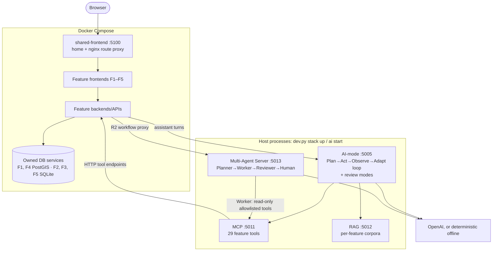

# System overview

How PropertyScope NSW is built and run, with the Release 2 additions in detail. It summarises the
code and points to the documents that hold the detail. Checked against the code on 22 October 2026.

## In one paragraph

Five students each own one feature slice (frontend + backend/API + database). The slices run in
Docker Compose behind one shared edge. The AI tier (AI-mode, MCP, RAG and, from Release 2, the
Multi-Agent Server) runs as **host processes, never containers** (ADR-046, ADR-047). Backends reach
the AI tier over HTTP via `host.docker.internal` with bearer tokens. Features share data only
through HTTP contracts. Release 2 added the Multi-Agent Server, three review modes in the agentic
loop, pre-commit security scans, per-student endpoint CI and an Azure deployment gated on that CI.

## Big picture



Hard rules (enforced by `scripts/validate_architecture.py` in the gate):

- A student slice never imports another slice, `agent_core` or `multi_agent_server`.
- Only the owning DB service opens a database file. AI services never touch a feature database.
- Shared packages stay domain-neutral.
- No AI service in any Compose file, and no Dockerfile under `ai-services/`.

## Repository map

| Path | What lives there |
|---|---|
| `student-N/` | One feature: `frontend/`, `backend/`, `database/`, `feature.yaml`, `tool-catalog.yaml`, `config/rag/corpus.json`, `config/multi-agent/workflow.yaml` (R2), `tests/endpoints/` (R2) |
| `ai-services/agent-core/` | Deterministic agent loop: run state machine, tools, grounding, recovery |
| `ai-services/ai-mode/` | Run API (`/api/v1/agent-runs`), providers, model registry, prompts, `release_review.py` (R2 review validation) |
| `ai-services/mcp-server/`, `rag-server/` | Tool transport over feature endpoints; local embeddings (`BAAI/bge-small-en-v1.5`) and cited retrieval |
| `ai-services/multi-agent-server/` | **R2.** Planner/Worker/Reviewer, state machine, SQLite + JSONL audit, HTTP API, CLI |
| `shared/contracts/` | Pydantic contracts, JSON Schemas, OpenAPI. Includes `multi_agent` and `evidence_review` (R2) |
| `shared/testkit/` | Test doubles. R2 adds `EndpointClient`, `junit_summary`, `FakeMultiAgentServer` |
| `shared/frontend/` | Shell, design system, chat. R2 adds `multi-agent/`, the shared workflow panel |
| `shared/tool-runtime/`, `consumer-protocol/` | HTTP tool runtime; cross-feature consumer protocol |
| `deployment/` | `features.yaml` → generated `enabled-features.*` (ports, routes, Compose). R2 adds `azure/` |
| `scripts/` | `check.py` (gate), `dev.py` (every workflow), evidence capture, report builders |
| `scripts/devtools/review/` | **R2.** Review-mode collectors, checklist, CLI and human release decision |
| `scripts/security/` | **R2.** detect-secrets and pip-audit wrappers, `accepted-risks.toml`, security report |
| `.github/workflows/` | `integration-ci.yml`, `student-1..5.yml`; R2 adds `cloud-deployment.yml`, `cloud-ai.yml`, `cloud-auto-deallocate.yml` |
| `docs/release-2/` | Requirements, plan, review modes, showcase, and `evidence/` (everything the report cites) |
| `docs/reports/` | Report sources, Mermaid diagrams, rendered assets, submitted PDFs |

## Feature slices

| # | Owner | Feature | Port | DB | R2 workflow template | R2 endpoint tests |
|---|---|---|---|---|---|---|
| 1 | Matthew Shelton | Data platform, property discovery | 5200 | PostGIS | `f1-release-readiness-review` → `/release-reviews` | `student-1/tests/endpoints/` |
| 2 | Burhan Naeem | Sales explorer, market cases | 5300 | SQLite | `f2-market-case-brief` → `/market-briefs` | `student-2/tests/endpoints/` |
| 3 | James Huang | Suburb, crime, liveability | 5600 | SQLite | **none yet** | **none yet** |
| 4 | Michael White | Site, planning, due diligence | 5400 | PostGIS | `f4-evidence-readiness-review` → `/evidence-reviews` | `student-4/tests/endpoints/` |
| 5 | Derek Song | Buyer journey, workspaces | 5500 | SQLite | **none yet** | **none yet** |

Feature 1 is the data producer: it acquires official sources (G-NAF, NSW PSI sales, BOCSAR,
schools, SEIFA), and publishes reviewed releases that the other features consume over HTTP. Its
`f1-runner` downloads and parses sources, and `f1-db-loader` is the only process holding DB
credentials for imports. A fresh database holds a **seeded demonstration baseline**, not real data.

## Runtime

| Where | Started by | Contents |
|---|---|---|
| Docker Compose (~20 services) | `uv run scripts/dev.py stack up [--offline]` | Edge, 5 frontends, 5 backends, DB services, F1 runner/loader |
| Host processes | `stack up` (background) or `dev.py ai serve <svc>` (foreground terminal) | AI-mode, MCP, RAG, Multi-Agent Server |

- Host state, tokens, histories and model cache: `.propertyscope-runtime/` (ignored by Git).
- AI modes: `direct` (AI-mode calls feature tools itself), `mcp`, `combined` (MCP + RAG).
  `--offline` runs direct mode with no provider key and leaves MCP/RAG stopped.
- Ports and routes come from `deployment/enabled-features.v1.json`, generated from each `feature.yaml`.

## Request flows

**CRUD (R0).** Browser → edge `:5100` → feature frontend → feature backend → its DB service.

**Assistant turn (R1).** Feature UI → backend `assistant/turns` → AI-mode `POST /api/v1/agent-runs`
→ loop plans tool calls → MCP → that feature's allowlisted tool endpoints, plus RAG retrieval
from that feature's corpus → cited answer with a confidence category → backend → UI.

**Multi-agent workflow (R2).**

```text
Feature UI (shared multi-agent panel)
  → feature backend proxy routes (template id fixed server-side, other features' runs hidden)
  → Multi-Agent Server POST /api/v1/multi-agent/runs  (202, runs in background)
      Planner   builds a plan from the template's required steps
      Worker    runs each step with read-only allowlisted tools (via MCP, or HTTP in direct mode)
      Reviewer  applies the template's deterministic checks; a model can add findings, not overrule
  → awaiting_human
  → person decides in the panel or terminal: approve | correct | partial | reject
      correct (round 1) re-runs Worker + Reviewer with the note; correct in round 2 ends as `corrected`
  → terminal state; panel shows history + audit
```

The agents never choose the outcome; only a human decision leaves `awaiting_human`. Without a
model key a rule-based provider produces every stage, so offline and CI runs still work.

## Release 2 additions

### 1. Multi-Agent Server — `ai-services/multi-agent-server/`

- Host process on `:5013`, `Authorization: Bearer $MULTI_AGENT_SERVICE_TOKEN`. ADR-047.
- A feature declares a workflow in `student-N/config/multi-agent/workflow.yaml`: inputs, objective,
  `allowed_tools` (must be read-only and owned by that feature), required `steps`, `reviewer_checks`
  (severity: critical → reject, high → correct, medium → partial).
- Every state change goes to `workflow_history.jsonl`. Every coordination event (handoffs, model
  calls, tool calls, decisions) goes to `coordination_audit.jsonl`. SQLite is the source of truth.
- Terminal path: `uv run multi-agent-server run --template ID --input JSON --review --server`.
- Evidence: `multi-agent-server export RUN_ID --out docs/release-2/evidence/multi-agent/student-N/<run> --server`.
- Detail: [Multi-Agent Server README](../../ai-services/multi-agent-server/README.md).

### 2. Feature integration

- Backend: proxy routes over HTTP using `MULTI_AGENT_BASE_URL` and the token. Tests use
  `shared_testkit.FakeMultiAgentServer`, never the real package.
- Frontend: mounts [`shared/frontend/multi-agent/`](../../shared/frontend/multi-agent/README.md),
  which shows live stage lanes, the human-decision form and replays of recorded runs.
- Wired today: F1, F2, F4 (templates + routes). The F5 backend has the env vars but no template. F3 has neither.

### 3. Agentic-loop review modes — `scripts/devtools/review/`

| Command | Reviews |
|---|---|
| `dev.py ai review multi-agent` | Each student's exported workflow history + audit |
| `dev.py ai review testing` | Security scan outputs + each student's CI endpoint evidence |
| `dev.py ai review cloud` | Deployment report, release gate, image build, smoke output, logs |
| `dev.py ai review decide --decision release\|hold\|rollback` | Records the named human release decision |

How a review runs: a collector reads allowlisted evidence files and hashes them, then builds a
deterministic checklist. The checklist becomes the objective of a normal AI-mode run (`feature_key`
`agentic-loop`, one read-only tool `review.evidence.v1`). The model writes a review. AI-mode validates
it against the schema and the evidence. The final verdict is the **stricter** of the model's verdict
and the checklist's. Output is
`docs/release-2/evidence/reviews/<mode>-review.md` plus a line in `<mode>-validation-log.jsonl`.
`--deterministic` runs the same loop with scripted decisions (CI/offline). Every check names an owner.
A student with missing evidence fails one gate check, and that student's other checks show as
`blocked`. The group verdict cannot pass while any owner's evidence is missing.
Detail: [review-modes.md](../release-2/review-modes.md).

### 4. Pre-commit security — `.pre-commit-config.yaml`

On every `git commit`: Ruff lint/format, mypy, then three security hooks: **Ruff `S` rules**,
**detect-secrets** against `.secrets.baseline`, and **pip-audit** of `uv.lock` (runs when lock or
`pyproject.toml` files change). Pre-push runs the full gate `check.py pre-push`. Accepted
vulnerabilities live in `scripts/security/accepted-risks.toml` with reasons. Report:
`uv run scripts/dev.py security report` → `docs/release-2/evidence/security/`. `integration-ci.yml`
also runs the scans in its `security` job.

### 5. Post-commit endpoint CI — `student-N.yml`

Each push to `main` triggers each student's workflow: lint, types, tests with coverage, build only
that feature's images, start its Compose stack, then `pytest student-N/tests/endpoints -m endpoint`
against the running service (≥2 endpoint functions). JUnit summary and artifact are uploaded.
`scripts/collect_ci_evidence.py --student N` writes `evidence/ci/student-N.md` for the testing review.

### 6. Azure deployment — `deployment/azure/`, ADR-048

```text
commit → pre-commit hooks → push main → integration-ci.yml + student-1..5.yml
  → cloud-deployment.yml
      verify-ci       all six workflows green for this SHA      (scripts/verify_release_gate.py)
      build-validate  build every image, validate Azure Compose (scripts/validate_release_images.py)
      deploy          env `production`, OIDC login → deploy.sh provision → push → deploy → smoke → report
  → Azure VM, public HTTPS
```

- **Topology.** One Ubuntu VM (`Standard_D4as_v4`, `newzealandnorth`, Azure for Students) runs the
  same Compose model plus `docker-compose.azure.yml`. A VM is used because the AI tier must stay a
  host process, which rules out container-only services.
- **Resources (Bicep, `main.bicep` + `modules/`).** VNet, an NSG allowing 80/443 only (no SSH,
  no DB ports), public IP with DNS label, ACR (images tagged by Git SHA, admin user off), Key Vault
  (RBAC, purge protection, firewall), managed identity (AcrPull, Secrets User), budget.
- **Edge.** Caddy (`shared-edge-proxy`, the only container that publishes ports) handles TLS, HSTS,
  a site login and operator auth on AI/ops/multi-agent routes. It forwards to the unchanged nginx
  edge, which adds rate limits.
- **Operations.** No SSH: everything goes through `az vm run-command` calling
  `vm/propertyscope-vm.sh`. Entry point: `deploy.sh {provision,secrets,push,deploy,smoke,status,logs,ai on|off,ai-probe,validate-endpoint,validate-data}`.
- **AI tier off by default** (rubric requirement). The four systemd units in `systemd/` start only with
  `PROPERTYSCOPE_CLOUD_AI=true`, applied by `docker-compose.azure-ai.yml` and `cloud-ai.yml`.
  With it off, AI routes return `503 ai_disabled`.
- **Cost controls.** `cloud-auto-deallocate.yml` deallocates the VM nightly. Automatic deploys are
  paused (`AZURE_AUTO_DEPLOY=false`), so deploy with a manual dispatch.
- Detail: [deployment/azure/README.md](../../deployment/azure/README.md).

### 7. Bonus (B1–B6)

| | What | Evidence |
|---|---|---|
| B1–B4 | AI-mode, MCP, RAG, Multi-Agent on Azure via `cloud-ai.yml` / `deploy.sh ai on` + `ai-probe` | `evidence/bonus/cloud-ai-probe.*`, `bonus/ui/` |
| B5 | Endpoint security: TLS, HSTS, headers, site + operator auth, rate limits, NSG | `validate-endpoint-security.sh` → `bonus/endpoint-security.txt` |
| B6 | Data security: Key Vault, managed identity, file secrets, encryption at host, internal DB networks, IMDS guard | `validate-data-security.sh` → `bonus/data-security.txt` |

## Evidence and the report

All Release 2 evidence lives in `docs/release-2/evidence/`:

| Folder | Producer |
|---|---|
| `security/` | `dev.py security report` |
| `ci/` | `scripts/collect_ci_evidence.py --student N` |
| `multi-agent/student-N/` | `multi-agent-server export` (terminal and UI runs) |
| `local/` | `scripts/capture_local_deployment.py` (live checks + six terminal logs) |
| `cloud/` | `cloud-deployment.yml` artifact + `cloud_smoke.py`, `cloud_deployment_report.py`, portal screenshots |
| `reviews/` | `dev.py ai review <mode>` and `decide` |
| `bonus/` | `deploy.sh ai-probe`, `validate-*-security.sh` |

`scripts/refresh_release2_evidence.py --final` re-captures all of it in order (preflight, security,
ci, local, ui, reviews, report) and only runs on a clean `main` that matches `origin/main`.

**Report generator** (`scripts/build_release2_report.py`) turns the Markdown source
[`docs/reports/release-2-technical-report.md`](../reports/release-2-technical-report.md) into
`docs/reports/submissions/release-2/group-20.pdf`. It uses the shared engine `scripts/report_pdf.py`.

- Placeholders such as `[[FEATURE_FLOWS]]`, CI, review, multi-agent and cloud tables are filled from
  `evidence/` at build time. A missing file becomes a TODO.
- `[[TODO: Owner | ...]]` lines render as callouts in drafts.
- Diagrams are Mermaid in `docs/reports/diagrams/release-2/`, rendered to `assets/release-2/`, hash-bound by manifest.
- 3,000-word limit, budgeted per section. `--status` shows the budget and each owner's TODOs.
- `--final --baseline <sha>` refuses to build while any TODO, pending image, missing evidence or
  word overrun remains.

```text
uv run python scripts/build_release2_report.py --status
uv run python scripts/build_release2_report.py [--render-diagrams]
uv run python scripts/build_release2_report.py --final --baseline <40-char sha>
```

## Rubric → where it is

| # | Criterion | Implementation | Report § |
|---|---|---|---|
| 1 | Integrated local app + AI services | Compose stack + four host services | 3, 8 |
| 2 | Multi-Agent Server, terminal + UI | `ai-services/multi-agent-server/`, shared panel, feature proxies | 3, 10 |
| 3 | Pre-commit security | `.pre-commit-config.yaml`, `scripts/security/` | 5 |
| 4 | Two endpoint tests per student | `student-N/tests/endpoints/`, `student-N.yml` | 6 |
| 5 | Cloud deployment scripts | `deployment/azure/deploy.sh`, Bicep | 4, 9 |
| 6 | `cloud-deployment.yml` after CI | `verify-ci` → `build-validate` → `deploy` | 4, 9 |
| 7 | Cloud CRUD, AI off | `cloud_smoke.py` (CRUD per feature + `503 ai_disabled`) | 9 |
| 8 | Three review modes + logs | `scripts/devtools/review/`, `evidence/reviews/` | 7, 9, 10 |
| 9 | Report + evidence | `build_release2_report.py` | all |
| 10 | Showcase | [showcase-runbook.md](../release-2/showcase-runbook.md) | 14 |
| B1–B6 | Cloud AI + security | `cloud-ai.yml`, `validate-*-security.sh` | 13 |

## Commands you will actually use

```text
uv sync --locked --all-packages --all-groups
uv run scripts/dev.py stack up [--offline]          # everything, locally
uv run scripts/dev.py stack doctor | status
uv run scripts/dev.py ai serve multi-agent          # one host service in its own terminal
uv run scripts/dev.py ai probe
uv run scripts/dev.py ai review testing --deterministic
uv run python scripts/check.py                      # full gate before handoff
```

## Further reading

[README](../../README.md) · [AGENTS.md](../../AGENTS.md) · [Shared platform design](shared-platform-design.md) ·
[Release 2 status](../release-2/README.md) · [Implementation plan](../release-2/implementation-plan.md) ·
[ADR-046](decisions/ADR-046-non-containerised-ai-tier.md) · [ADR-047](decisions/ADR-047-multi-agent-server.md) ·
[ADR-048](decisions/ADR-048-azure-vm-hosting.md)
