# PropertyScope NSW

**Release 2 / Technical report**

41026 Advanced Software Development — Assessment 3

| Submission | Group 20 |
|---|---|
| Team | Matthew Shelton, Burhan Naeem, James Huang, Michael White, Derek Song |
| Due | 25 October 2026, 11:59 pm Sydney time |
| Repository | [MattShelton04/41026ASDProject](https://github.com/MattShelton04/41026ASDProject) |
| Showcase video | [https://www.youtube.com/watch?v=0GocJXh61VM](https://www.youtube.com/watch?v=0GocJXh61VM) |
| Commit reference | [[BASELINE]] |
| Deployed code and evidence | `7b3fb43` |

<!--
Authors: the brief allows 3,000 words. Cover text, captions, tables, generated tables and code
blocks all count; diagram pixels, TODO callouts and these comments do not. Run
`uv run python scripts/build_release2_report.py --status` to see each chapter against its budget
and your outstanding TODOs. Replace each TODO with your content; stay inside your share.
-->

[[PAGEBREAK]]

[[TOC]]

## 1 Project overview

PropertyScope NSW helps buyers research NSW property. Each student owns a containerised frontend,
backend/API and database slice; Matthew also leads the shared platform. Release 2 keeps the
Release 0–1 AI-mode, agentic loop, MCP and RAG servers, and adds:

- a host Multi-Agent Server (Planner → Worker → Reviewer → human review), called through a
  feature's backend;
- three review modes: multi-agent workflow, testing report and cloud deployment;
- pre-commit security scans, and a `student-N.yml` per student for post-commit endpoint tests;
- Azure deployment with the AI tier disabled by default.

| Student | Feature | Release 2 responsibility |
|---|---|---|
| 1 Matthew Shelton (24763373) | F1 Data platform and property discovery | Shared platform (Multi-Agent Server, review modes, security scans, test kit, Azure); F1 workflow and endpoint tests |
| 2 Burhan Naeem (24764134) | F2 Property sales and market cases | Workflow, endpoint tests, evidence |
| 3 James Huang (24970865) | F3 Suburb, crime and liveability analytics | Workflow, endpoint tests, evidence |
| 4 Michael White (24846267) | F4 Site, planning and building due diligence | Workflow, endpoint tests, evidence |
| 5 Derek Song (24833978) | F5 Buyer journey workspace | Workflow, endpoint tests, evidence |

## 2 Final repository structure

| Path | Contents | Release |
|---|---|---|
| `student-1/` … `student-5/` | Feature slices: UI, API, database service, tools, corpus | 0–1 |
| `student-N/config/multi-agent/`, `student-N/tests/endpoints/` | Each feature's workflow template and endpoint tests | 2 |
| `ai-services/{ai-mode,agent-core}/` | AI-mode run API and the shared agentic loop | 0 |
| `ai-services/{mcp-server,rag-server}/` | Tool transport and local retrieval | 1 |
| `ai-services/multi-agent-server/` | Planner, Worker, Reviewer, decisions, JSONL audit, CLI | 2 |
| `scripts/devtools/review/` | Review modes and release decision | 2 |
| `shared/frontend/multi-agent/`, `shared/testkit/` | Shared workflow panel; endpoint client, JUnit summary, `FakeMultiAgentServer` | 2 |
| `.pre-commit-config.yaml`, `scripts/security/` | Security hooks and report | 2 |
| `.github/workflows/` | `student-N.yml`, `integration-ci.yml`; `cloud-deployment.yml` | 0–2 |
| `deployment/azure/`, `docker-compose.azure.yml` | Bicep, VM scripts, TLS edge, systemd AI units | 2 |
| `docs/release-2/evidence/` | Security, CI, multi-agent, review, local and cloud evidence | 2 |

## 3 Release 2 design flow

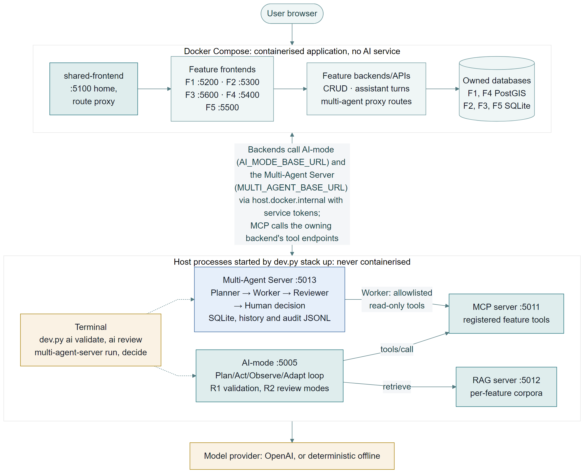

CRUD requests pass from the browser through the shared edge to a feature frontend, its backend/API
and its own database service. Assistant turns keep the Release 1 path through AI-mode to the
feature's MCP tools and RAG corpus. A backend with a workflow also proxies the Multi-Agent Server
over HTTP with a service token through proxy routes that fix the template server-side and hide
other features' runs; the shared panel shows each stage up to the human decision. No AI service
opens a feature database or runs in Docker.

[[FEATURE_FLOWS]]

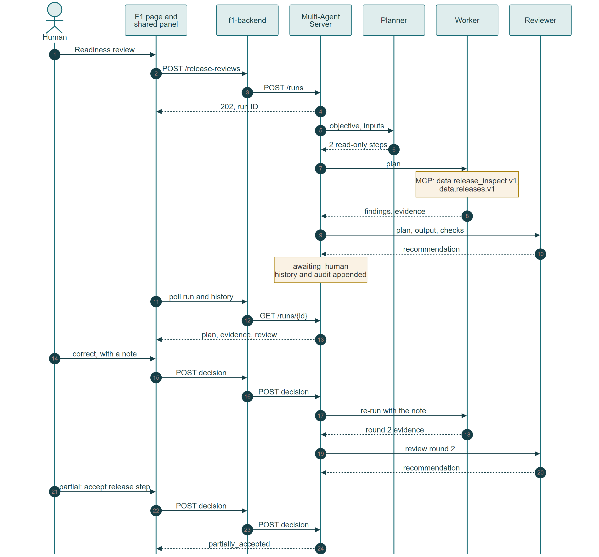

### Student 1

`f1-release-readiness-review` recommends whether a candidate dataset release is ready to publish.
Seven proxy routes sit under `/api/data-platform/v1/release-reviews`. The allowlist omits `data.release_publish.v1`, so a review never
publishes.

### Student 2

`f2-market-case-brief` summarises one saved market case's sale observations. Eight proxy routes
sit under `/api/market-intelligence/v1/market-briefs`. Both allowlisted tools, `market.cases.inspect.v1` and `market.sales.summary.v1`,
are read-only.

### Student 3

`f3-suburb-comparison-review` checks one saved suburb comparison against its published crime
evidence. Eight proxy routes sit under `/api/suburb-analytics/v1/comparison-reviews`. Both allowlisted tools, `suburb.comparison.inspect.v1`
and `crime.saved-comparison-evidence.v1`, are read-only; a review never ranks suburb safety.

### Student 4

`f4-evidence-readiness-review` drafts a professional's verification questions from one saved
site review's evidence. Eight proxy routes sit under `/api/due-diligence/v1/evidence-reviews`. Both allowlisted tools,
`duediligence.review.inspect.v1` and `duediligence.evidence.summary.v1`, are read-only.

### Student 5

`f5-buyer-case-action-plan` proposes follow-ups from one buyer case's shortlist, notes, tasks and
research. Eight proxy routes under `/api/buyer-workspaces/v1/buyer-cases/{id}/evidence-reviews`
recheck case ownership. Its one read-only tool, `buyer.action-plan.context.v1`, takes only a
section; the backend, not the model, binds the case from the run.

## 4 Cloud deployment and CI/CD architecture

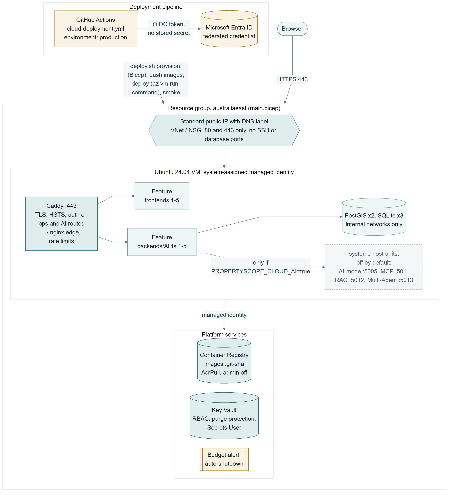

We chose Azure ([ADR-048](../architecture/decisions/ADR-048-azure-vm-hosting.md)): one Ubuntu VM
(`Standard_D4as_v4`, `newzealandnorth`) runs the Compose model with a production override, because
the AI tier must stay a host process. Its managed identity reads Container Registry and Key Vault;
GitHub signs in with OIDC. The NSG admits only 80 and 443, Caddy terminates TLS, and the four AI
systemd units stay off unless `PROPERTYSCOPE_CLOUD_AI=true`.

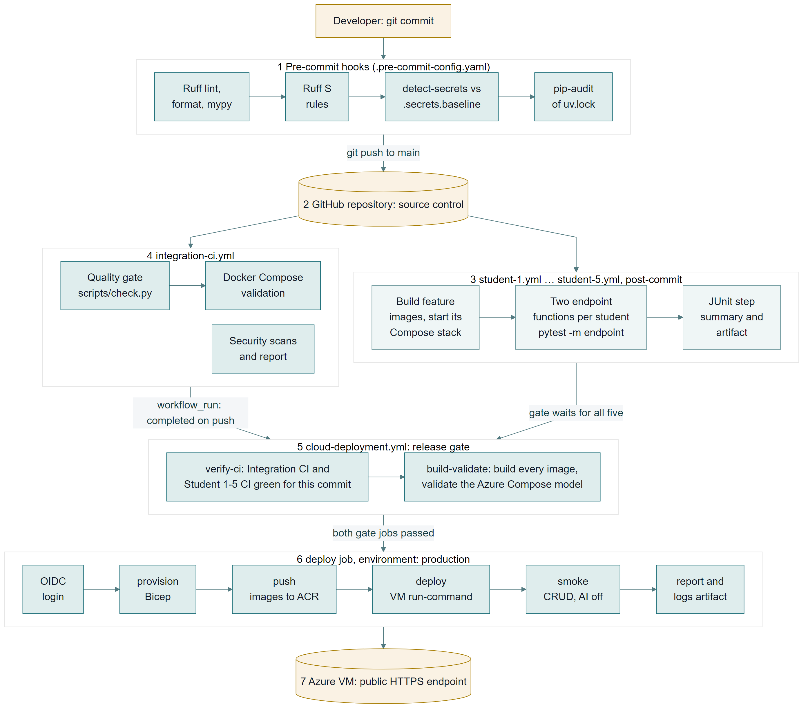

A commit runs the pre-commit hooks; a push to `main` runs `integration-ci.yml` and the five
`student-N.yml` workflows, whose endpoint tests are each owner's deliverable. `cloud-deployment.yml`
gates the release: `verify-ci` waits until all six pass for the commit and `build-validate` builds
and validates every image. Only then does `deploy` run these reusable
[scripts](../../deployment/azure/README.md) in the protected `production` environment:

| Script or template | Role |
|---|---|
| `deploy.sh provision`, `secrets` | Resource group, `main.bicep`, missing Key Vault secrets |
| `deploy.sh push`, `deploy` | Images to ACR; VM converged through `az vm run-command` |
| `deploy.sh smoke`, `status`, `logs` | Public smoke test and VM state |
| `deploy.sh ai on`/`off`, `ai-probe` | Bonus AI tier and its B1–B4 probe |
| `deploy.sh validate-endpoint`, `validate-data` | B5 and B6 checks |
| `main.bicep`, `modules/` | Network, registry, Key Vault, VM, RBAC, shutdown, budget |
| `validate-iac.sh` | Offline Bicep, shell, Caddy and nginx checks (CI `iac-lint`) |

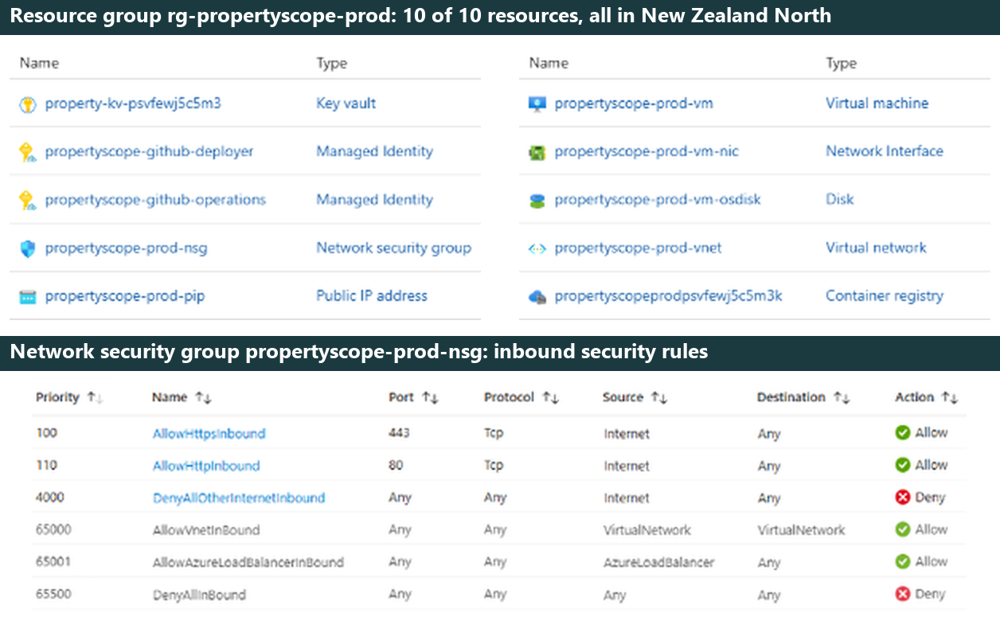

## 5 Pre-commit security testing

`.pre-commit-config.yaml` runs three security hooks on every `git commit`: Ruff `S`
(flake8-bandit) rules, detect-secrets against the reviewed `.secrets.baseline`,
and pip-audit of `uv.lock`. `integration-ci.yml` repeats them on every push.
`dev.py security report` records results per slice and owner:

[[SECURITY_SUMMARY]]

In the recorded [commit run](../release-2/evidence/security/pre-commit-commit-run.txt),
detect-secrets first blocked the commit; after seven false positives were reviewed into the
baseline, it passed:

```text
security: Ruff flake8-bandit rules (S)..........................Passed
security: detect-secrets against .secrets.baseline..............Passed
security: pip-audit of locked dependencies (uv.lock)............Passed
```


## 6 Post-commit CI/CD testing

Each owner's `student-N.yml` starts the feature's Compose stack with AI disabled, runs
`pytest -m endpoint` on at least two endpoint functions and publishes the Shared test kit's JUnit summary (at
least two passes). `collect_ci_evidence.py` keeps each run's record, reports and log.

[[CI_EVIDENCE]]

### Student 1

`student-1.yml` loads fixture data, then tests the feature origin (:5200) and the shared edge
(:5100):

1. `GET /api/data-platform/v1/properties/search`: contract-valid ranked matches for an accepted
   address; invalid queries return structured problems.
2. `/api/data-platform/v1/sources`: create, list, read, update and delete a source definition;
   invalid, duplicate and non-JSON bodies are rejected and not persisted.

### Student 2

`student-2.yml` tests two endpoint functions on the feature origin (:5300):

1. `POST /api/market-intelligence/v1/market-cases`: a valid case is persisted at version 1
   and readable at its own URL; a window that ends before it starts is refused `422
   invalid_market_case` and writes nothing.
2. `PUT /api/market-intelligence/v1/market-cases/{id}`: the current version applies the
   change and advances the version; a stale version is refused `409 version_conflict` and
   leaves the first writer's value in place.

### Student 3

`student-3.yml` tests two endpoint functions on the feature origin (:5600):

1. `GET /api/suburb-analytics/v1/suburbs`: `limit=2` returns a bounded page of two NSW suburbs
   from at least ten seeded; a non-numeric limit returns a `422` Problem Details response.
2. `POST /api/suburb-analytics/v1/suburb-comparisons`: a valid comparison is persisted at version
   1, readable at its own URL, then deleted (`404 comparison_not_found`); an unknown measure is
   refused `422 invalid_request` and writes nothing.

### Student 4

`student-4.yml` tests two endpoint functions on the feature origin (:5400):

1. `POST /api/due-diligence/v1/site-reviews`: a valid review is persisted as a version 1 draft,
   readable at its own URL and then deleted; five invalid bodies and a non-JSON body are refused
   `422 invalid_site_review` and write nothing.
2. `GET /api/due-diligence/v1/site-reviews/{id}/evidence`: a seeded review returns schema-valid
   constraint and building records for its own property only; an unknown or deleted review
   returns `404 site_review_not_found`.

### Student 5

`student-5.yml` tests two endpoint functions on the feature origin (:5500):

1. `POST /api/buyer-workspaces/v1/buyer-cases`: a valid case is persisted active at version 1,
   readable at its own URL, echoes the request ID and hides `owner_ref`; an inverted budget is
   refused `422 validation_failed`.
2. `POST /api/buyer-workspaces/v1/buyer-cases/{id}/tasks`: a task is persisted incomplete at
   version 1, readable and listed under its case; an unknown case returns
   `404 resource_not_found`.

## 7 Testing review

`dev.py ai review testing` checks the security report and each `ci/student-N.md` against a
deterministic checklist and through the shared loop; the stricter verdict wins.

[[REVIEW_SUMMARY testing]]

The finding's 73 pip-audit records are the 55 accepted advisory IDs in Section 5, some listed
more than once; none is open.

## 8 Local deployment evidence

`dev.py stack up` starts the four host AI services, then the Compose application; backends reach
them through `host.docker.internal`. `capture_local_deployment.py` checks the running system,
including that each AI service is a host process in its own terminal, not a container.

[[LOCAL_EVIDENCE]]

## 9 Cloud deployment report and review

`deploy.sh smoke` checks the home page, every feature route, create, read and delete per feature,
and that AI-mode answers `503 ai_disabled`; all 37 checks passed. `dev.py ai review cloud`
reviews the evidence, then a named person records the release decision with `ai review decide`,
which refuses if the evidence changed.

[[CLOUD_SUMMARY]]

Run [40041985429](https://github.com/MattShelton04/41026ASDProject/actions/runs/40041985429)
deployed the submitted code: `verify-ci` 4 min 37 s (waiting for this commit's CI),
`build-validate` 45 s, `deploy` 9 min 28 s ([run record](../release-2/evidence/cloud/workflow-run.md),
[step logs](../release-2/evidence/cloud/logs/),
[`vm-deploy.log`](../release-2/evidence/cloud/vm-deploy.log)). Run
[39098352903](https://github.com/MattShelton04/41026ASDProject/actions/runs/39098352903) also
ran the Bicep provision step (1 min 29 s).

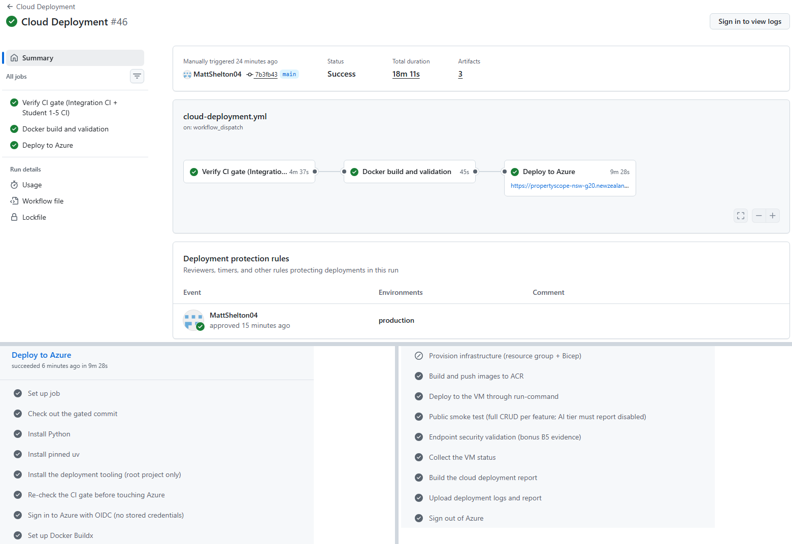

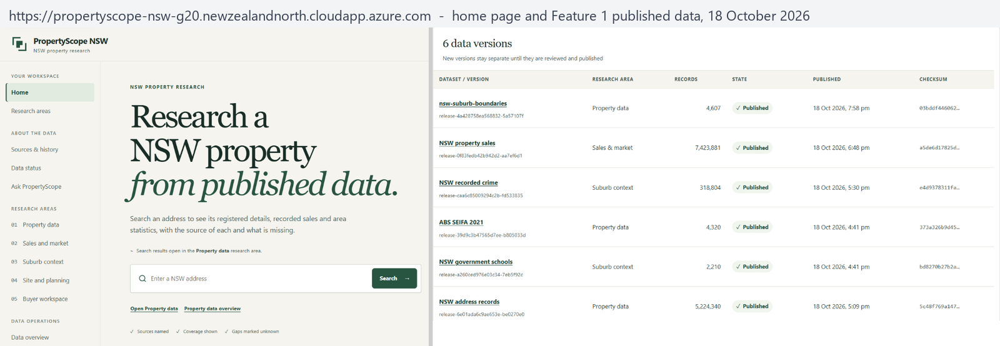

[[REVIEW_SUMMARY cloud]]

## 10 Multi-agent workflow evidence

The server keeps runs in SQLite, state transitions in `workflow_history.jsonl`, and handoffs,
model and tool calls and decisions, with actor and time, in `coordination_audit.jsonl`;
`multi-agent-server export` copies a run into the evidence.

[[MULTI_AGENT_RUNS student-1/18740ca5-ui student-2/f1c290a2-ui student-3/5338d71c-ui student-4/2956e465-ui student-5/e9600341-d1fd-4836-befb-5607f705f797]]

### Multi-agent workflow review

`dev.py ai review multi-agent` checks every export for all four stages, legal transitions,
attributed human decisions and allowlisted tool calls.

[[REVIEW_SUMMARY multi-agent]]

### Student 1

UI run `18740ca5` (10 October, model provider) reviewed a real 680-record ABS CPI candidate.
Round 1: the Reviewer recommended approve; the human chose correct, asking for completeness against
ABS. Round 2: the Reviewer recommended correct, as read-only tools cannot fetch ABS totals; the
human accepted step `release` only, publishing nothing. Terminal run `c17c66cc` used the same
template:

[[WORKFLOW_HISTORY multi-agent/student-1/c17c66cc-terminal]]

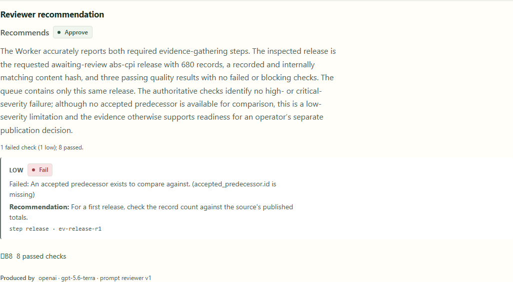

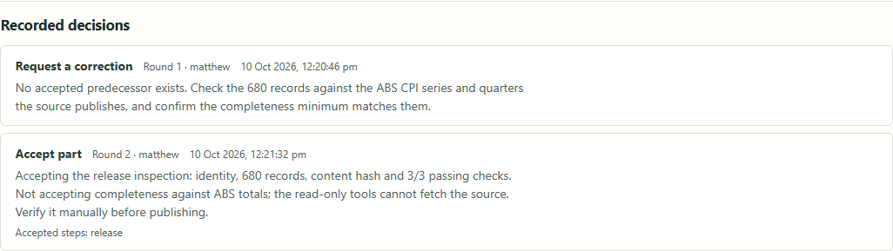

### Student 2

UI run `f1c290a2` briefed `Sydney example – full history`. The Reviewer recommended approve on
all eleven checks passing. Burhan sent it back: the checks read the tool results, while the prose
summary reported the figures without the limitations. Round two restated them with the
synthetic-data disclosure, and Burhan approved it, 0 failed and 11 passed.

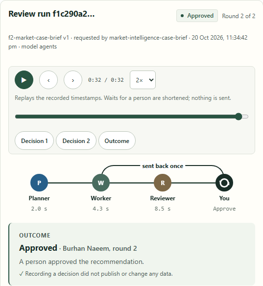

### Student 3

UI run `5338d71c` reviewed seeded comparison `comparison-10` (Newcastle and Wollongong, rate). The
Reviewer recommended correct: coverage was unavailable, the denominator invalid and the seeded-data
disclosure missing. It was sent back; round two added the disclosure, the Reviewer again recommended
correct, and it was rejected until counts are used or the missing BOCSAR months are published.

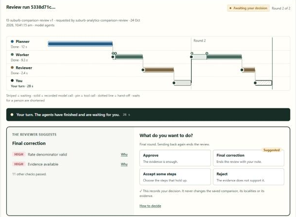

### Student 4

UI run `2956e465` reviewed seeded review 1 (11 Example Street, Sydney). The Reviewer recommended
approve on all ten checks passing. Michael sent it back: the draft referred to the saved question
list, missed two conflicting records and did not plainly disclose seeded data. Round two disclosed
the seeded data and both conflicts, and Michael approved it, noting three of five questions still to
write by hand.

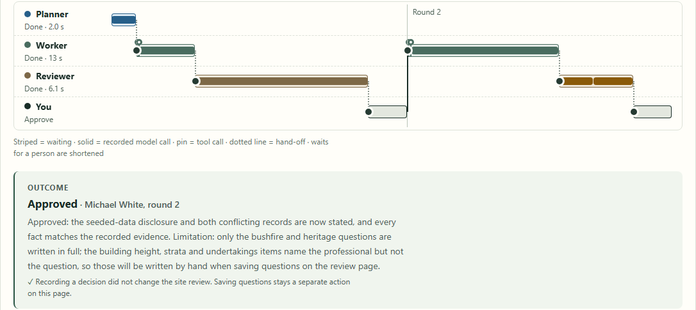


### Student 5

UI run `e9600341` reviewed seeded case `Wollongong coastal review`. The Reviewer recommended correct:
the Worker proposed no actions. Derek sent it back; round two still had none, and the Reviewer
recommended partial (one high, two medium failures). Derek approved it anyway.

## 11 GitHub commit logs

Commit history:
[https://github.com/MattShelton04/41026ASDProject/commits/main](https://github.com/MattShelton04/41026ASDProject/commits/main).
Section 12 lists each student's commits.

[[PAGEBREAK]]

## 12 Contribution logs

### Student 1 Matthew Shelton

| Date | Commit | Release 2 work |
|---|---|---|
| 8–10 Oct | [36a4c26](https://github.com/MattShelton04/41026ASDProject/commit/36a4c26), [f86f787](https://github.com/MattShelton04/41026ASDProject/commit/f86f787), [bef57da](https://github.com/MattShelton04/41026ASDProject/commit/bef57da), [06e0ed0](https://github.com/MattShelton04/41026ASDProject/commit/06e0ed0) | Multi-Agent Server, review modes, security scans, test kit, panel, F1 review |
| 15–17 Oct | [d449a43](https://github.com/MattShelton04/41026ASDProject/commit/d449a43), [07b1c81](https://github.com/MattShelton04/41026ASDProject/commit/07b1c81), [72f3272](https://github.com/MattShelton04/41026ASDProject/commit/72f3272), [fdc5111](https://github.com/MattShelton04/41026ASDProject/commit/fdc5111), [93d0f53](https://github.com/MattShelton04/41026ASDProject/commit/93d0f53) | CI and local evidence, report builder, release gate |
| 17 Oct | [5e90231](https://github.com/MattShelton04/41026ASDProject/commit/5e90231), [ad2b443](https://github.com/MattShelton04/41026ASDProject/commit/ad2b443), [71764a5](https://github.com/MattShelton04/41026ASDProject/commit/71764a5), [cd8e56d](https://github.com/MattShelton04/41026ASDProject/commit/cd8e56d) | Azure switch-on, site login, security fixes |
| 18 Oct | [b638c86](https://github.com/MattShelton04/41026ASDProject/commit/b638c86), [53a2143](https://github.com/MattShelton04/41026ASDProject/commit/53a2143), [65de8f6](https://github.com/MattShelton04/41026ASDProject/commit/65de8f6), [b71c49c](https://github.com/MattShelton04/41026ASDProject/commit/b71c49c), [3c25c08](https://github.com/MattShelton04/41026ASDProject/commit/3c25c08), [c1dab31](https://github.com/MattShelton04/41026ASDProject/commit/c1dab31), [3ea2932](https://github.com/MattShelton04/41026ASDProject/commit/3ea2932), [817ef77](https://github.com/MattShelton04/41026ASDProject/commit/817ef77), [0cf5e3f](https://github.com/MattShelton04/41026ASDProject/commit/0cf5e3f) | F1 suburb-map API, real data and Cloud AI Tier on Azure, cloud and bonus evidence, release decision |
| 19 Oct | [daee27d](https://github.com/MattShelton04/41026ASDProject/commit/daee27d), [70f3b9a](https://github.com/MattShelton04/41026ASDProject/commit/70f3b9a) | Report against the rubric, B1–B4 UI captures |
| 22–24 Oct | [002691e](https://github.com/MattShelton04/41026ASDProject/commit/002691e), [d7602b7](https://github.com/MattShelton04/41026ASDProject/commit/d7602b7), [81c833d](https://github.com/MattShelton04/41026ASDProject/commit/81c833d), [7b3fb43](https://github.com/MattShelton04/41026ASDProject/commit/7b3fb43) | CVE fixes, review bundle limits, CI resilience, cold-start smoke retry |

### Student 2 Burhan Naeem

| Date | Commit | Release 2 work |
|---|---|---|
| 21 Oct | [4162bbd](https://github.com/MattShelton04/41026ASDProject/commit/4162bbd) | Market case brief: workflow template, eight proxy routes, panel; endpoint tests in `student-2.yml`; Ruff `S` findings cleared |
| 21 Oct | [24e6025](https://github.com/MattShelton04/41026ASDProject/commit/24e6025) | CI evidence and Feature 2 report sections |

### Student 3 James Huang

| Date | Commit | Release 2 work |
|---|---|---|
| 22 Oct | [08a9331](https://github.com/MattShelton04/41026ASDProject/commit/08a9331) | Suburb comparison review: workflow template, two read-only tools, eight proxy routes, panel; endpoint tests in `student-3.yml`; edge protection and Azure Multi-Agent settings |
| 23 Oct | [bc5e46e](https://github.com/MattShelton04/41026ASDProject/commit/bc5e46e) | Suburb boundary and amenity map from Feature 1, saving from the comparison page |

### Student 4 Michael White

| Date | Commit | Release 2 work |
|---|---|---|
| 21 Oct | [58def77](https://github.com/MattShelton04/41026ASDProject/commit/58def77) | Endpoint tests in `student-4.yml`; Ruff `S` findings cleared |
| 21 Oct | [aa9b866](https://github.com/MattShelton04/41026ASDProject/commit/aa9b866) | Evidence readiness review: workflow template, eight proxy routes, review-page panel; Release 1 question-extraction fix |
| 21 Oct | [37b2ffc](https://github.com/MattShelton04/41026ASDProject/commit/37b2ffc) | CI, security and multi-agent evidence; Feature 4 report sections |

### Student 5 Derek Song

| Date | Commit | Release 2 work |
|---|---|---|
| 23 Oct | [a400cb0](https://github.com/MattShelton04/41026ASDProject/commit/a400cb0) | Buyer case action plan: workflow template (v1, v2), case-bound read-only tool, eight proxy routes, panel; endpoint tests in `student-5.yml`; Ruff `S` findings cleared; security and multi-agent evidence |

## 13 Bonus evidence

We claim B1–B6. B1–B4 ran through the public edge in Cloud AI Tier run
[39119158736](https://github.com/MattShelton04/41026ASDProject/actions/runs/39119158736)
(`817ef779`, 18 October), and again before the showcase in
[39720293518](https://github.com/MattShelton04/41026ASDProject/actions/runs/39720293518) (`dedda460`, 22 October).

| Tier | Result and evidence | Run or source |
|---|---|---|
| B1 AI-mode | [PASS](../release-2/evidence/bonus/cloud-ai-probe.md) | AI-mode run `387591f0` |
| B2 MCP | [PASS](../release-2/evidence/bonus/cloud-ai-probe.md) | `data.releases.v1` over MCP, same run |
| B3 RAG | [PASS](../release-2/evidence/bonus/cloud-ai-probe.md) | Run `56c85266`, 2 citations |
| B4 Multi-Agent | [PASS](../release-2/evidence/bonus/cloud-ai-probe.md) | Run `2058658b`, rejected in the [UI](../release-2/evidence/bonus/README.md#ui-captures-19-october) |
| B5 Endpoint security | [58 PASS, 0 FAIL](../release-2/evidence/cloud/endpoint-security.txt) | Cloud Deployment run 40041985429 |
| B6 Data security | [43 PASS, 0 FAIL](../release-2/evidence/cloud/data-security.txt) | Laptop, same deployment, 24 October |

B5 checks TLS 1.2+, the HTTPS redirect, HSTS, CSP and framing headers, the site login, and operator
credentials on AI and workflow routes. B6 checks Key Vault RBAC and purge protection, least-privilege
managed identity, encrypted disks, OIDC without secrets, and internal database networks.

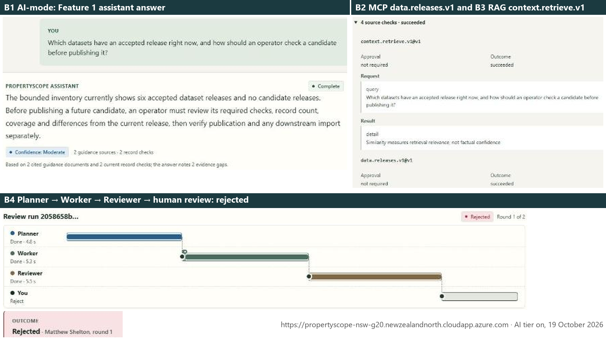

## 14 Showcase video

Showcase video: [https://www.youtube.com/watch?v=0GocJXh61VM](https://www.youtube.com/watch?v=0GocJXh61VM), a pre-recorded walkthrough in which all five members, Matthew Shelton, Burhan Naeem, James Huang, Michael White and Derek Song, present their work.

<!-- RELEASE2_METADATA
schema_version: 1
baseline: '[[BASELINE]]'
repository_url: https://github.com/MattShelton04/41026ASDProject
showcase_url: https://www.youtube.com/watch?v=0GocJXh61VM
sections:
  overview: 1 Project overview
  repository: 2 Final repository structure
  design: 3 Release 2 design flow
  architecture: 4 Cloud deployment and CI/CD architecture
  security: 5 Pre-commit security testing
  ci: 6 Post-commit CI/CD testing
  testing_review: 7 Testing review
  local: 8 Local deployment evidence
  cloud: 9 Cloud deployment report and review
  multi_agent: 10 Multi-agent workflow evidence
  commits: 11 GitHub commit logs
  contributions: 12 Contribution logs
  bonus: 13 Bonus evidence
  showcase: 14 Showcase video
evidence:
- kind: security-report
  section: 5 Pre-commit security testing
  path: docs/release-2/evidence/security/pre-commit-report.md
  boundary: Local scans of clean main at 7b3fb43; no pending-owner findings.
- kind: ci
  student: 1
  section: 6 Post-commit CI/CD testing
  path: docs/release-2/evidence/ci/student-1.md
  boundary: Successful student-1.yml push run on main at 7b3fb43; AI tier disabled in CI.
- kind: ci
  student: 2
  section: 6 Post-commit CI/CD testing
  path: docs/release-2/evidence/ci/student-2.md
  boundary: Successful student-2.yml push run on main at 7b3fb43; AI tier disabled in CI.
- kind: ci
  student: 3
  section: 6 Post-commit CI/CD testing
  path: docs/release-2/evidence/ci/student-3.md
  boundary: Successful student-3.yml push run on main at 7b3fb43; AI tier disabled in CI.
- kind: ci
  student: 4
  section: 6 Post-commit CI/CD testing
  path: docs/release-2/evidence/ci/student-4.md
  boundary: Successful student-4.yml push run on main at 7b3fb43; AI tier disabled in CI.
- kind: ci
  student: 5
  section: 6 Post-commit CI/CD testing
  path: docs/release-2/evidence/ci/student-5.md
  boundary: Successful student-5.yml push run on main at 7b3fb43; AI tier disabled in CI.
- kind: local-deployment
  section: 8 Local deployment evidence
  path: docs/release-2/evidence/local/local-deployment-report.md
  boundary: Local ps-dev stack on clean main at 7b3fb43 with real published data; host AI services in foreground terminals outside Docker.
- kind: cloud-deployment
  section: 9 Cloud deployment report and review
  path: docs/release-2/evidence/cloud/cloud-deployment-report.md
  boundary: Azure production VM at 7b3fb43 with the AI tier off; real accepted Feature 1 releases.
- kind: cloud-workflow
  section: 9 Cloud deployment report and review
  url: https://github.com/MattShelton04/41026ASDProject/actions/runs/40041985429
  boundary: Manual dispatch on main, gate passed, production environment approved by a person.
- kind: cloud-review
  section: 9 Cloud deployment report and review
  path: docs/release-2/evidence/reviews/cloud-review.md
  boundary: Shared-loop review through live AI-mode of the committed cloud evidence.
- kind: release-decision
  section: 9 Cloud deployment report and review
  path: docs/release-2/evidence/cloud/release-decision.md
  boundary: Named person's decision on review be5514a8, bound to the hashed evidence bundle.
- kind: testing-review
  section: 7 Testing review
  path: docs/release-2/evidence/reviews/testing-review.md
  boundary: Shared-loop review through live AI-mode of the committed security and CI evidence.
- kind: multi-agent-review
  section: Multi-agent workflow review
  path: docs/release-2/evidence/reviews/multi-agent-review.md
  boundary: Shared-loop review through live AI-mode of the exported workflow histories and audits.
- kind: multi-agent
  student: 1
  section: 10 Multi-agent workflow evidence
  path: docs/release-2/evidence/multi-agent/student-1/18740ca5-ui/summary.md
  boundary: Live local stack, model provider, real ABS CPI candidate; nothing published.
- kind: multi-agent
  student: 2
  section: 10 Multi-agent workflow evidence
  path: docs/release-2/evidence/multi-agent/student-2/f1c290a2-ui/summary.md
  boundary: Live local stack, model provider, seeded market case; read-only tools, nothing written.
- kind: multi-agent
  student: 3
  section: 10 Multi-agent workflow evidence
  path: docs/release-2/evidence/multi-agent/student-3/5338d71c-ui/summary.md
  boundary: Live local stack, model provider, seeded suburb comparison; read-only tools, nothing written.
- kind: multi-agent
  student: 4
  section: 10 Multi-agent workflow evidence
  path: docs/release-2/evidence/multi-agent/student-4/2956e465-ui/summary.md
  boundary: Live local stack, model provider with a deterministic round-2 Reviewer fallback, seeded site review; read-only tools, nothing written.
- kind: multi-agent
  student: 5
  section: 10 Multi-agent workflow evidence
  path: docs/release-2/evidence/multi-agent/student-5/e9600341-d1fd-4836-befb-5607f705f797/summary.md
  boundary: Live local stack, model provider, seeded buyer case; approved over a partial final recommendation.
contributions:
- student: 1
  section: Student 1 Matthew Shelton
  commits:
  - 36a4c26
  - f86f787
  - bef57da
  - 06e0ed0
  - d449a43
  - 07b1c81
  - 72f3272
  - fdc5111
  - 93d0f53
  - 5e90231
  - ad2b443
  - 71764a5
  - cd8e56d
  - b638c86
  - 53a2143
  - 65de8f6
  - b71c49c
  - 3c25c08
  - c1dab31
  - 3ea2932
  - 817ef77
  - 0cf5e3f
  - daee27d
  - 70f3b9a
  - 002691e
  - d7602b7
  - 81c833d
  - 7b3fb43
- student: 2
  section: Student 2 Burhan Naeem
  commits:
  - 4162bbd
  - 24e6025
- student: 3
  section: Student 3 James Huang
  commits:
  - 08a9331
  - bc5e46e
- student: 4
  section: Student 4 Michael White
  commits:
  - 58def77
  - aa9b866
  - 37b2ffc
- student: 5
  section: Student 5 Derek Song
  commits:
  - a400cb0
attendance:
  1: Matthew Shelton
  2: Burhan Naeem
  3: James Huang
  4: Michael White
  5: Derek Song
-->
